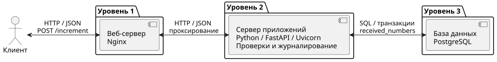
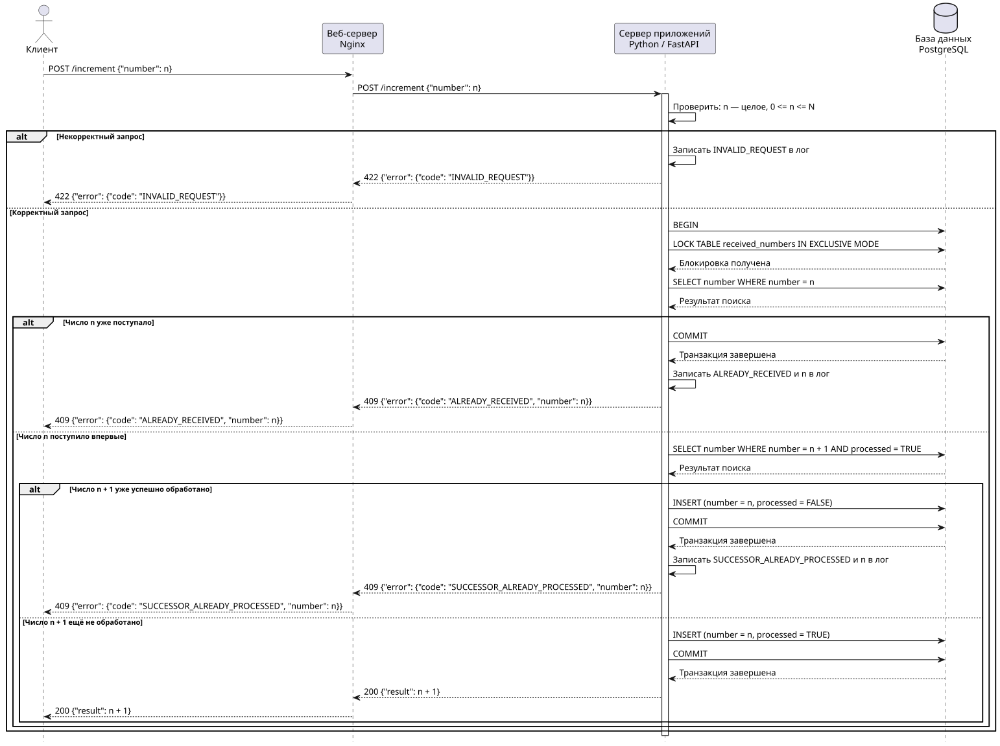

# Achievement #2

Клиент ↔ веб-сервер Nginx ↔ сервер приложений Python/FastAPI ↔ база данных PostgreSQL.

| Сложность | Решение |
| --- | --- |
| Стандартная | [Диаграмма компонентов](01_standard/components.svg) · [PlantUML](01_standard/components.puml) |
| Средняя | [Диаграмма последовательностей](02_medium/sequence.svg) · [PlantUML](02_medium/sequence.puml) |
| Высокая | [Реализация на Python](03_high/app.py) · [Docker Compose](03_high/compose.yaml) |

## Диаграмма компонентов

## Диаграмма последовательностей

